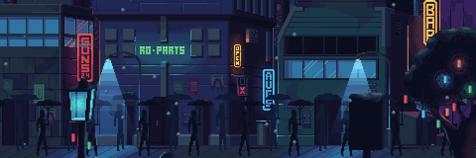

<div align="center">



<a href="https://alanchriss.me">
  
</a>
<br/>


<br/>

[](https://alanchriss.me)
[](https://www.linkedin.com/in/alan-chris-disilva)
[](https://buymeacoffee.com/alanchris)

</div>

<br/>

<h2 align="center">▸ CHARACTER SELECT ◂</h2>

<div align="center">
<table>
<tr>
<td>

```text
 ╔══════════════════════════════════════════╗
 ║  PLAYER ...... Alan Chris D'Silva        ║
 ║  CLASS ....... Developer                 ║
 ║  SKILL ....... Codes for fun             ║
 ║  BASE ........ alanchriss.me             ║
 ║  HP .......... ■■■■■■■■■□  90/100        ║
 ║  STATUS ...... ONLINE ▌                  ║
 ╚══════════════════════════════════════════╝
```

</td>
</tr>
</table>

<sub>(〃￣︶￣)人(￣︶￣〃)</sub>
</div>

<br/>

<h2 align="center">▸ INVENTORY ◂</h2>

<div align="center">

<sub><b>LANGUAGES</b></sub><br/>


<br/><br/>

<sub><b>FRONTEND &nbsp;·&nbsp; BACKEND</b></sub><br/>


<br/><br/>

<sub><b>DATA &nbsp;·&nbsp; AI &nbsp;·&nbsp; DATABASES</b></sub><br/>


<br/><br/>

<sub><b>CLOUD &nbsp;·&nbsp; TOOLS &nbsp;·&nbsp; GAME DEV</b></sub><br/>


<br/><br/>

<sub><b>BONUS ITEMS</b></sub><br/>


</div>

<br/>

<h2 align="center">▸ HIGH SCORES ◂</h2>

<div align="center">


</div>

<br/>

<h2 align="center">▸ FINAL STAGE ◂</h2>

<div align="center">


</div>
