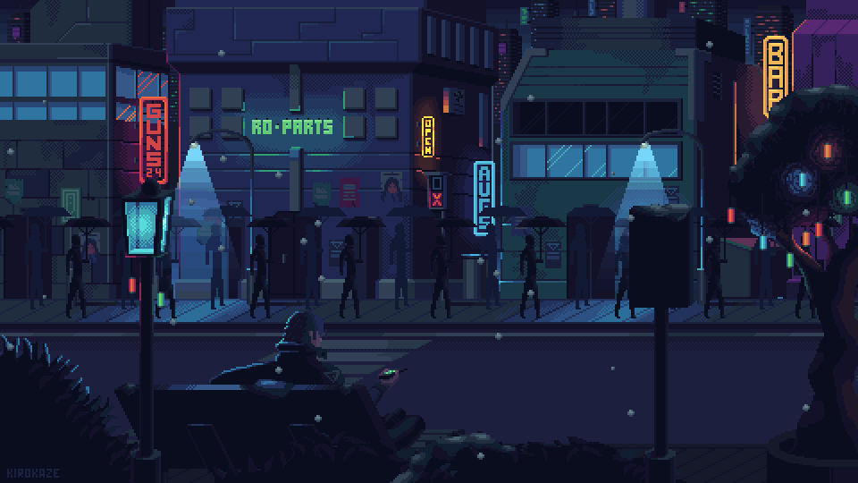

<div align="center">


<a href="https://alanchriss.me">
  
</a>



</div>

---

## 👾 `[ PLAYER 1 ]`

```text
╔═══[ CHARACTER SELECT ]════════════════════
║  NAME ......... Alan Chris D'Silva
║  CLASS ........ Forward Deployed Engineer
║  ALIGNMENT .... codes for fun (〃￣︶￣)人(￣︶￣〃)
║  BASE ......... alanchriss.me
║  HP ........... ■■■■■■■■■□  90/100
║  STATUS ....... ONLINE ▌
╚═══════════════════════════════════════════
```

<div align="center">

[](https://alanchriss.me)
[](https://www.linkedin.com/in/alan-chris-disilva)
[](https://instagram.com/ft.alxn)
[](https://github.com/alan61503)

</div>

---

## 🐍 `[ STAGE 1: THE SNAKE ]`

<div align="center">


<sub>`>` the snake respawns every 6 hours and eats my latest commits_</sub>

</div>

---

## 🎮 `[ INVENTORY ]`

<details open>
<summary><b>⚔️ Languages</b></summary>
<br/>

              

</details>

<details open>
<summary><b>🛡️ Frontend</b></summary>
<br/>

              

</details>

<details open>
<summary><b>⚙️ Backend & APIs</b></summary>
<br/>

         

</details>

<details open>
<summary><b>💾 Databases</b></summary>
<br/>

      

</details>

<details open>
<summary><b>🧠 Data & ML</b></summary>
<br/>

        

</details>

<details open>
<summary><b>☁️ Cloud & DevOps</b></summary>
<br/>

             

</details>

<details open>
<summary><b>🕹️ Game Dev & Creative</b></summary>
<br/>

         

</details>

---

## 🏆 `[ HIGH SCORES ]`

<div align="center">


</div>

---

## 🪙 `[ INSERT COIN ]`

<div align="center">

Enjoying the run? Drop a coin in the machine.

[](https://buymeacoffee.com/alanchris)


</div>
